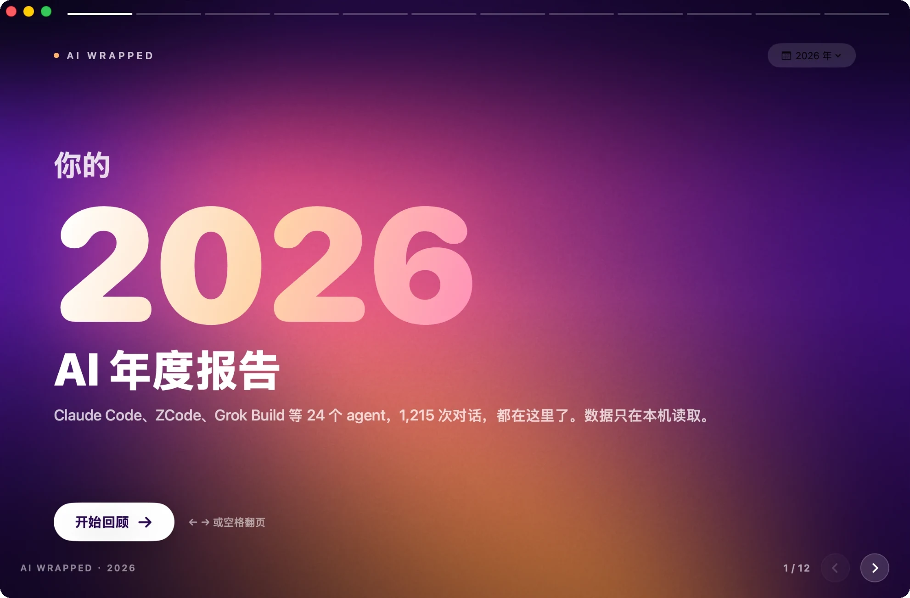
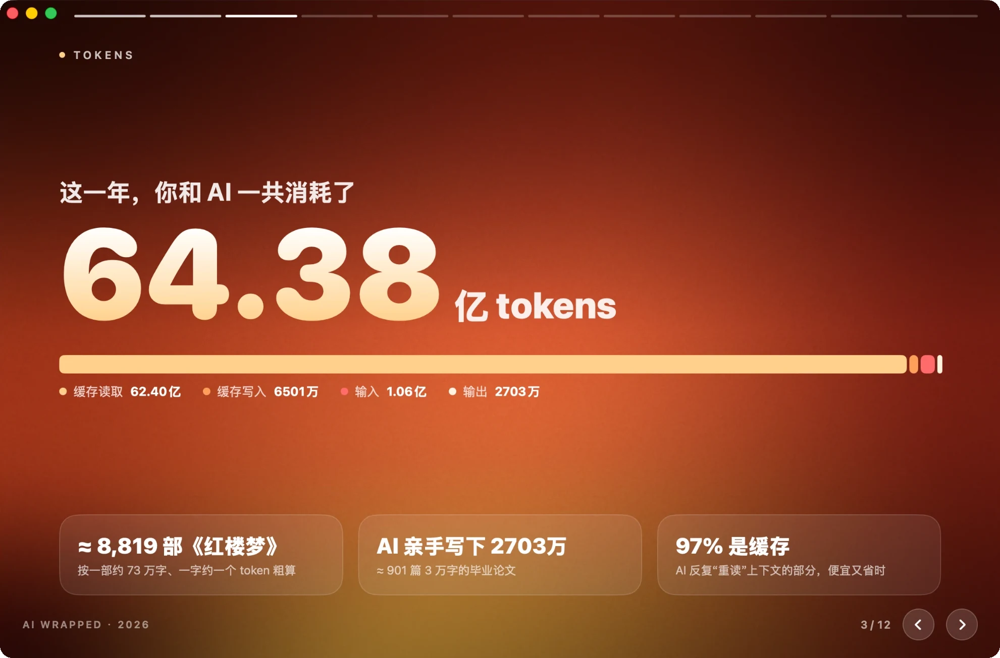
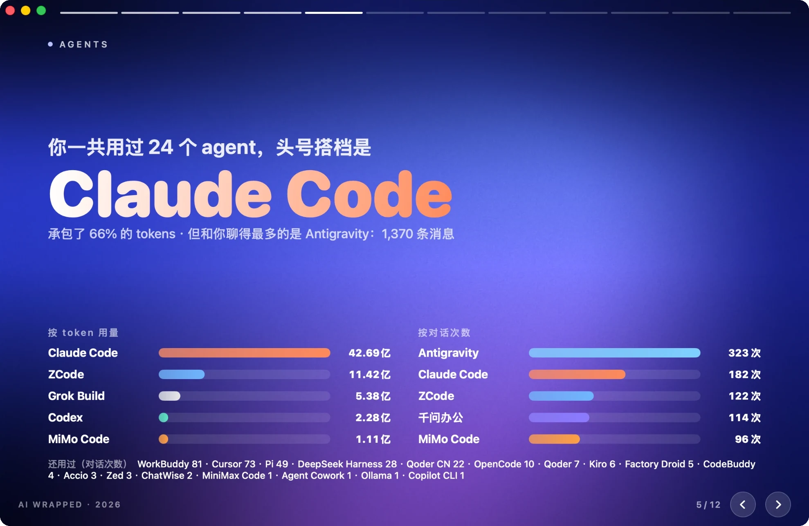
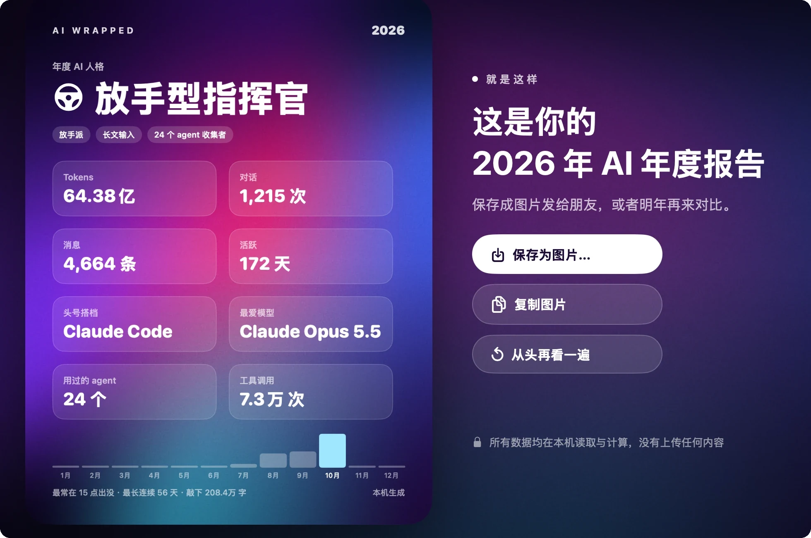

# AI 年度报告 (AI Wrapped)

读取你电脑上各个 AI agent 的聊天记录，做成一份可以翻页的年度回顾。有 macOS 和 Windows 两个版本，数据只在本机读取。

**下载：** 到 [Releases](../../releases/latest) 下载对应系统的文件。

- **macOS 15+**（Apple 芯片和 Intel）：`AI-Wrapped-*-mac.dmg`，打开后拖进「应用程序」。应用未经 Apple 公证，第一次打开若提示无法验证，到「系统设置 → 隐私与安全性」点「仍要打开」。
- **Windows 10/11**：`AI-Wrapped-*-setup.exe`（安装包）或 `AI-Wrapped-*-portable.exe`（免安装）。首次运行若出现 SmartScreen 提示，点“更多信息 → 仍要运行”。

<p align="center">
  
  
</p>
<p align="center">
  
  
</p>

一共 12 页：封面 · 第一句话 · Token 用量 · 对话 · Agent 排行 · 模型 · 工具与子 agent · 作息时钟 · 活跃日历 · 项目 · 年度 AI 人格 · 分享卡片（可存成图片或复制）。封面右上角可以切换年份或看全部时间。

**周报 / 月报：** 封面右上角选“本周 / 上周 / 本月”，或点封面上的“本周小结”。第一页是本期小结：Tokens、对话、消息、活跃天数各带一个和上一期的涨跌对比（本周没过完时，对比上周的同一段，比如周一到周二），下面是每天的柱状图和“本周之最”，后面接 token、agent、模型、工具、作息、项目和分享卡片。

## 数据来源

只读、只在本机。有 token 的统计 token；只存了积分或只存对话的，统计对话和消息。

| Agent | 位置 | Token |
|---|---|---|
| Claude Code（CLI 与桌面端 Code） | `~/.claude/projects/**/*.jsonl` | ✅ |
| Codex | `~/.codex/sessions`、`archived_sessions` | ✅ |
| ZCode | `~/.zcode/cli/db/db.sqlite`（只算 `real_user` 消息） | ✅ |
| OpenCode | `~/.local/share/opencode/opencode.db` | ✅ |
| MiMo Code | `~/.local/share/mimocode/mimocode.db` | ✅ |
| Grok Build | `~/.grok/sessions/**/updates.jsonl`（每轮 `turn_completed`） | ✅ |
| Pi | `~/.pi/agent/sessions/**/*.jsonl` | ✅ |
| MiniMax Code | `~/.minimax/v2/sessions/**/ledger.jsonl` | ✅ |
| DeepSeek Harness | `~/.dsh/sessions/**/session.jsonl.zstd`（需要 `zstd`） | ✅ |
| WorkBuddy | `~/.workbuddy/projects` + `workbuddy.db`（云端会话只计次数） | ✅ 本地部分 |
| CodeBuddy | `~/.codebuddy/projects` | ✅ |
| Cursor | `Cursor/User/globalStorage/state.vscdb` 对话气泡 | ✅（Cursor 记的部分） |
| Accio | `~/.accio/accounts/**/*.messages.jsonl` | ✅ |
| Agent Cowork | `agent-cowork/sessions.db` | ✅ |
| Factory Droid | `~/.factory/sessions` | ✅ |
| Antigravity | `~/.gemini/antigravity*/brain/*/…/transcript.jsonl` + 会话索引 | — |
| 千问办公 / QoderWork CN | `~/.qwenworkcn/projects`、`~/.qoderworkcn/projects` | —（只记积分） |
| Qoder CN、Qoder | `~/.qoder-cn/projects`、`~/.qoder/projects` | —（只记积分） |
| Kiro | `~/.kiro/sessions/cli` + Kiro Crew | —（只记积分） |
| Copilot CLI、Ollama、ChatWise、Zed | 各自的本地 SQLite | — |

去重：Claude 格式按消息 id；千问办公与 QoderWork CN 的迁移副本按 id 合并；Cursor 的 agent-transcripts 是 IDE 对话的副本，只读 IDE 里没有的。
Token 总量 = 输入 + 输出 + 缓存读取 + 缓存写入；有的 agent 把缓存算进输入，扫描时按记录里的 total 自动判断并拆开。

## 构建

### macOS（Swift / SwiftUI）

需要 macOS 15+ 和 Swift 6 工具链（Command Line Tools 即可，不需要 Xcode）。

```bash
./build-app.sh
```

产物在 `dist/AI 年度报告.app`。`./build-app.sh --dmg` 另外打包 DMG，`UNIVERSAL=1` 同时编译 Apple 芯片和 Intel 版本。

```bash
.build/release/AIWrapped --dump --year 2026      # 打印统计数字
.build/release/AIWrapped --dump --all            # 全部时间
.build/release/AIWrapped --dump --period week    # 本周（也可以 lastweek / month）
.build/release/AIWrapped --snapshot out/ --year 2026   # 每一页导出 PNG
```

### Windows（Tauri：Rust + WebView2）

代码在 [`windows/`](windows)：`src-tauri/src` 是扫描与统计（和 macOS 版同一套规则，路径按 Windows 习惯：`%USERPROFILE%\.claude`、`%APPDATA%\Cursor` 等），`ui/` 是界面。推送到 `main` 时 GitHub Actions 会分别在 Windows 和 macOS 上编译、用样例数据自测扫描并截图；推送 `v*` 标签会把 Windows 安装包和 macOS DMG 一起发布到 Release。

```bash
cd windows && npm ci && npx tauri build                          # 在 Windows 上打包安装程序
cd windows/src-tauri && cargo run --profile fast -- --dump --all  # 任意平台：打印扫描结果
```

## 操作

← → / 空格 / 点击翻页；封面右上角切换年份或重新扫描；最后一页可保存或复制分享卡片。
